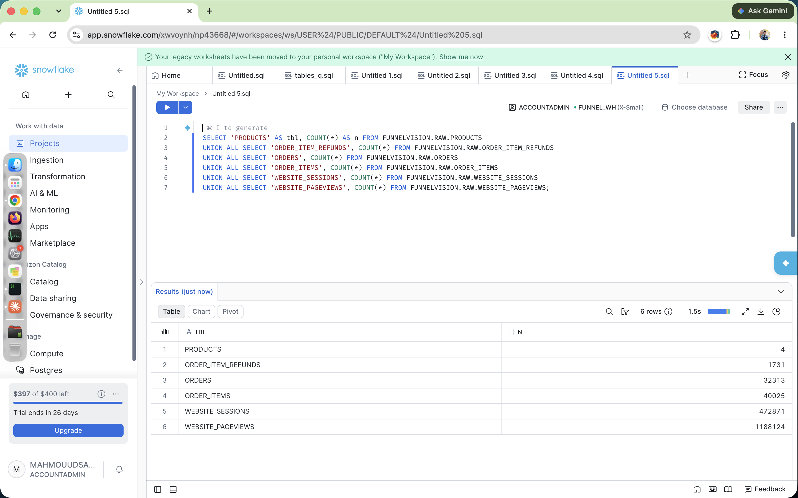
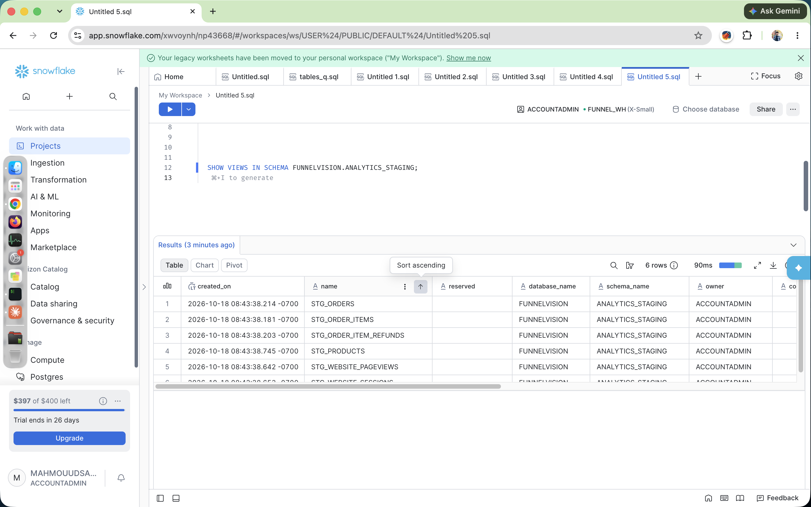
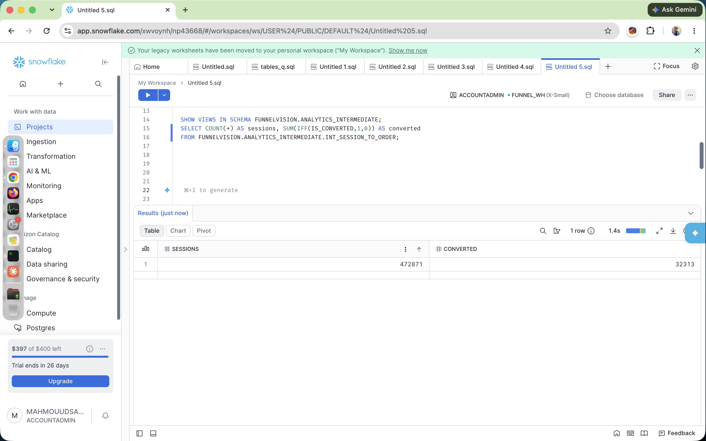
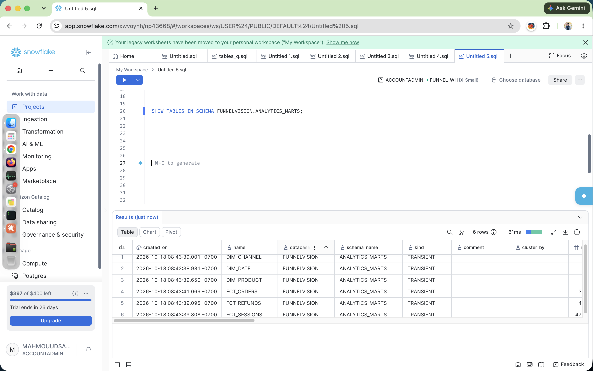
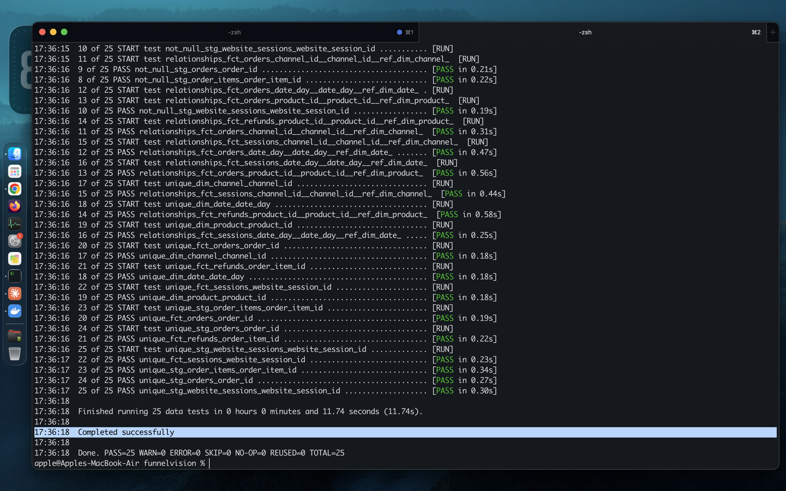
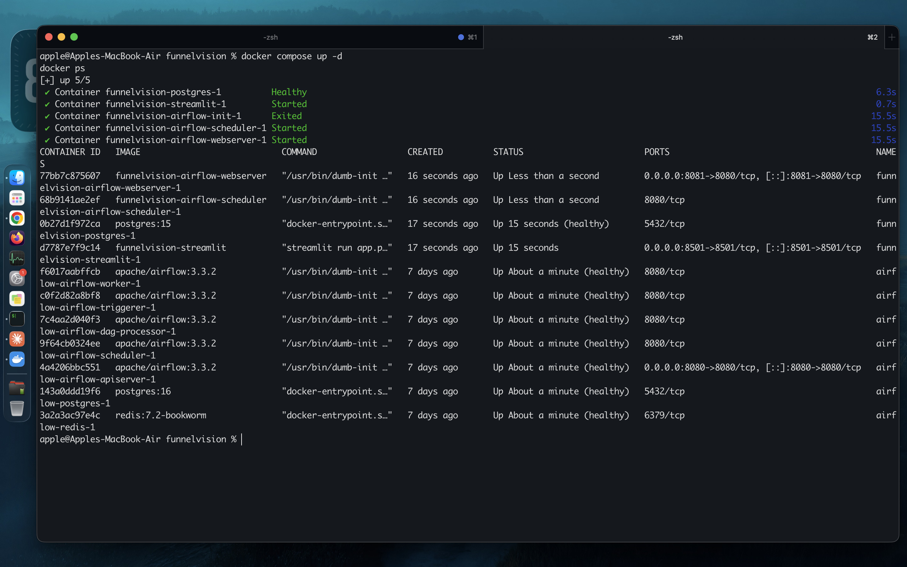
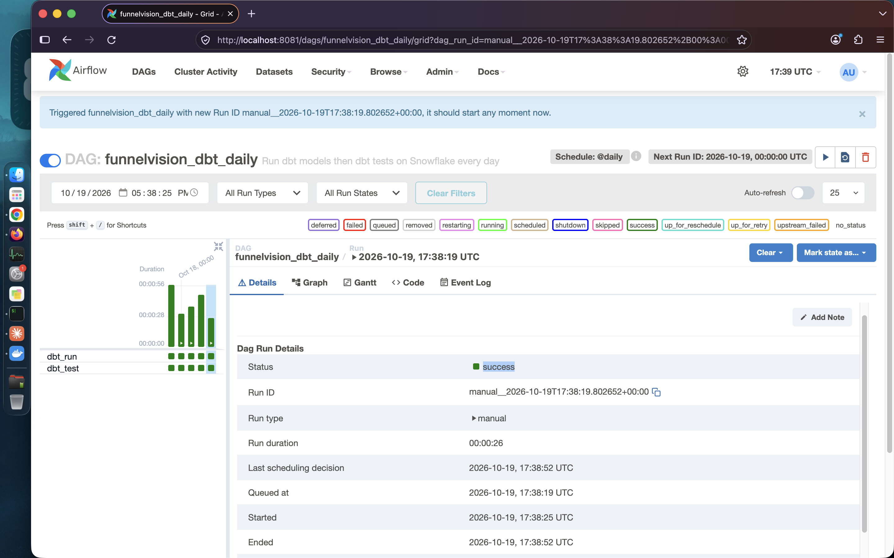
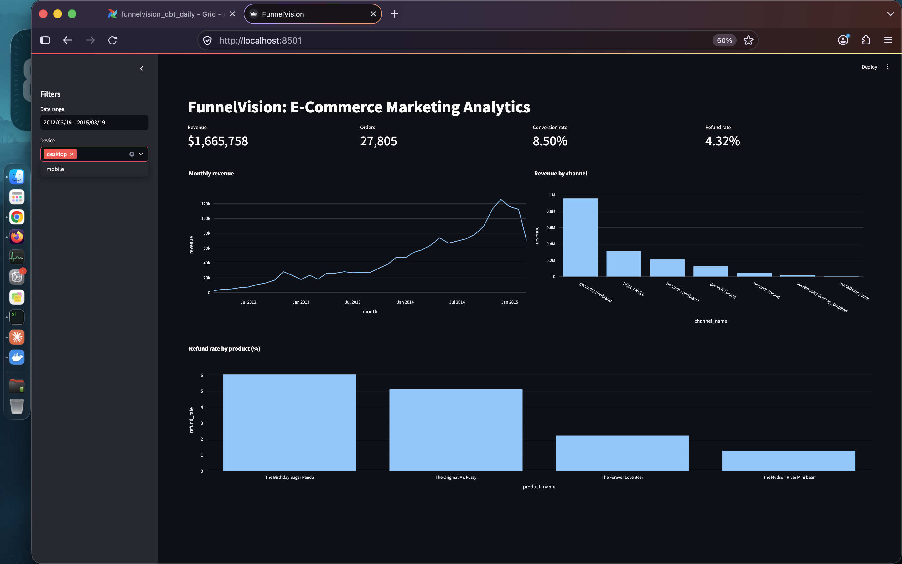

# FunnelVision: E-Commerce Marketing Funnel Analytics

End-to-end data pipeline for an online toy store (Maven Fuzzy Factory dataset).
It answers: which marketing channels bring visitors that actually convert into
orders, and which products get refunded?

## Architecture

```
CSV files -> Snowflake RAW -> dbt staging -> dbt intermediate -> dbt marts -> Streamlit
                                   ^
                        Airflow runs dbt run + dbt test daily
                        (everything runs in Docker)
```



## Stack

Snowflake, dbt (dbt-snowflake), Airflow, Docker Compose, Streamlit.

## Data model

- **Staging (6):** stg_website_sessions, stg_website_pageviews, stg_orders, stg_order_items, stg_order_item_refunds, stg_products
- **Intermediate (2):** int_session_to_order, int_order_items_with_refunds
- **Marts:** fct_sessions, fct_orders, fct_refunds, dim_product, dim_channel, dim_date
- **Tests:** not_null, unique, relationships (25 tests)

## Run from scratch

### 1. Prerequisites
- Docker Desktop (with File Sharing enabled for the project folder)
- A free Snowflake trial account

### 2. Snowflake setup
Run in a Snowsight worksheet:

```sql
USE ROLE ACCOUNTADMIN;
CREATE WAREHOUSE IF NOT EXISTS FUNNEL_WH
  WAREHOUSE_SIZE = 'XSMALL' AUTO_SUSPEND = 60 AUTO_RESUME = TRUE INITIALLY_SUSPENDED = TRUE;
CREATE DATABASE IF NOT EXISTS FUNNELVISION;
CREATE SCHEMA IF NOT EXISTS FUNNELVISION.RAW;
CREATE SCHEMA IF NOT EXISTS FUNNELVISION.ANALYTICS;
```

Download the dataset from
https://mavenanalytics.io/data-playground/toy-store-e-commerce-database
and load these 6 CSVs into `FUNNELVISION.RAW` using Snowsight
(Ingestion -> Add Data -> Load data into a table), with these table names:
`WEBSITE_SESSIONS`, `WEBSITE_PAGEVIEWS`, `ORDERS`, `ORDER_ITEMS`, `ORDER_ITEM_REFUNDS`, `PRODUCTS`.

### 3. Credentials
```bash
cp .env.example .env
```
Edit `.env` and set `SNOWFLAKE_ACCOUNT`, `SNOWFLAKE_USER`, `SNOWFLAKE_PASSWORD`.
Never commit `.env`.

### 4. Start everything
```bash
docker compose up -d
```

- Airflow: http://localhost:8081 (user `admin`, password `admin`)
- Streamlit dashboard: http://localhost:8501

### 5. Build the models
Trigger the DAG `funnelvision_dbt_daily` in Airflow (it runs `dbt run` then
`dbt test`). It is also scheduled daily.

Note: Airflow uses port 8081 because 8080 was occupied on the author's machine.
You can change it in `docker-compose.yaml`.

## Project structure

```
airflow/        Dockerfile (Airflow + dbt-snowflake) and DAGs
dbt_project/    dbt models (staging, intermediate, marts) and tests
streamlit/      Dashboard app and Dockerfile
docker-compose.yaml
.env.example
```

## Dashboard

4 KPIs (revenue, orders, conversion rate, refund rate), 3 charts
(monthly revenue, revenue by channel, refund rate by product),
filters for date range and device, queries cached with `st.cache_data`.

## Screenshots

| | |
|---|---|
|  |  |
|  |  |
|  |  |
|  |  |

## Ingestion

Raw CSVs live in `data/` (source: Maven Analytics, Fuzzy Factory).
`ingestion/load_raw.py` loads them into `FUNNELVISION.RAW` with Snowflake `PUT` + `COPY INTO`:

```bash
docker compose run --rm --no-deps --entrypoint bash \
  -v "$(pwd)/data:/opt/airflow/data" \
  -v "$(pwd)/ingestion:/opt/airflow/ingestion" \
  airflow-scheduler \
  -c "/home/airflow/dbt_venv/bin/python /opt/airflow/ingestion/load_raw.py"
```

Note: the largest file (`website_pageviews.csv`, 54 MB) failed to upload through the connector on the author's machine, so it was loaded with Snowsight (Load Data). You can load a single table with `... load_raw.py website_pageviews`.
